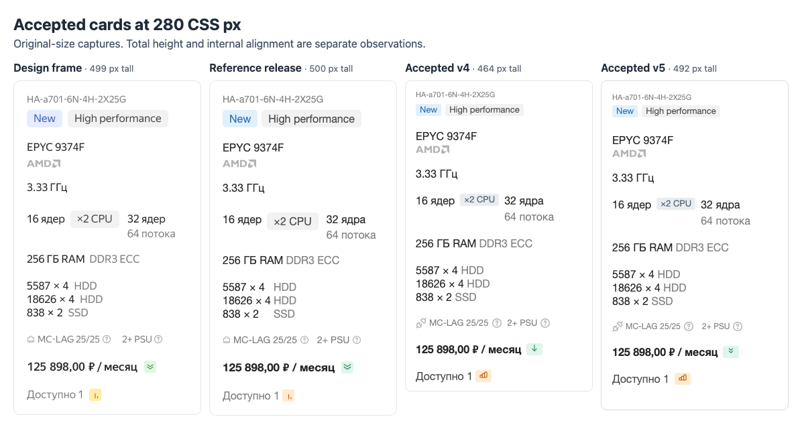

# Adaptive frontend: from a passing story to an accepted user journey

This is the development record for the experimental adaptive-frontend skill, whose last text is [draft 09](drafts/09-v6-visual-fidelity.md). It was never released: [design-to-code](../2026-11-20-design-to-code/README.md) replaced it. It follows work on a private component library through five local studies and the proposed sixth edition. The private application supplied realistic design frames, an existing implementation, consumers with different actions, and an accepted packaged reference. This public record preserves our skill texts, the methods, anonymized observations, measurements and disagreements. The owner authorized the [original full-comparison captures](visual/README.md) as a specific exception. Product sources, private links, other design material and session logs remain local.

[Open the visual report and 280 px measurements](visual/README.md) · [Download or inspect the complete gallery](visual/comparison.html) · [Time and resource accounting](timing.md)

## Result for the reviewer

A fresh worker could produce a usable first implementation. A working card demo was an unreliable indicator of delivery quality. In one full run the package built but its public import failed; in another the package worked but a second consumer still had a different renderer and lacked required data. Both workers disclosed a material gap and handed off anyway. Each eventually passed the agreed checks. Neither full-scope run achieved an accepted first submission.

The measured v4 took **54:31 of worker time and two returns**. Updated v5 took **1:17:56 and three returns** on the same task and historical source. V5 caught a packaging problem before first submission and was closer to two of four design-frame heights at final acceptance. Its first submission cost more and it needed an additional layout repair. The measurements provide no basis for a general speedup claim. The judge reused a costly verification setup on the second run; judge time, writer time and calendar time are reported separately.

V6 is a **candidate for ordinary use**, with no measured delivery result yet. It shortens the previous instructions and changes the evidence a worker should choose. When an element gets its meaning from its context, check it with the other elements that give it that meaning. After a repair, exercise the failure and the nearest earlier success that shares its layout. This would distinguish two saved submissions; whether a worker will choose such a test unaided on a new task remains open.

## Reading the record

| File | What it establishes |
|---|---|
| [Round ledger and full-text archive](rounds.md) | Which exact edition existed, what changed, which was actually used, which outputs were accepted, and where to retrieve the previous prompts in full |
| [Originating retrospective](retrospective.md) | What the owner had to send back, when information was available, how cross-project work amplified delays, and where judgement or a real owner decision was necessary |
| [Protocols and measured results](trials.md) | Five studies, controls, tasks, limits, first submissions, repairs, judge decisions, phase timings, selected token counts and the post-hoc replay |
| [Timing and resource accounting](timing.md) | All five studies: first submission, repairs, judging, support, calendar, token and tool counters, plus exclusions and measurement boundaries |
| [Role-level measurements](role-metrics.csv) | The recorded worker, observer and judge intervals and resource counters, with [accounting conventions and omissions](trials.md#reading-the-resource-counters) |
| [Full-task acceptance and failure catalogue](full-task.md) | The release comparison, what passed and failed at each handoff, why the two late layout repairs differed, actual dimensions, and what the pass leaves unproven |
| [External work and three independent readings](prior-work.md) | Public references examined, version pins, what was borrowed, suggestions declined and what the external reviews could establish |
| [V6 design and next test](next.md) | How the candidate differs from tested v5, what counts as a useful finding, and a low-cost prospective comparison before another full implementation |

Start with the two [full-task trials](trials.md#full-card-trials) to understand the cost. Read the [mixed-list counterexample](full-task.md#the-case-that-changed-v6) to review the actual new instruction. The [complete v6 snapshot](drafts/09-v6-visual-fidelity.md) is frozen here; further proposed and shipped versions belong to Entrust. Installing the plugin exposes the runtime skill. Its research history stays in this directory.
