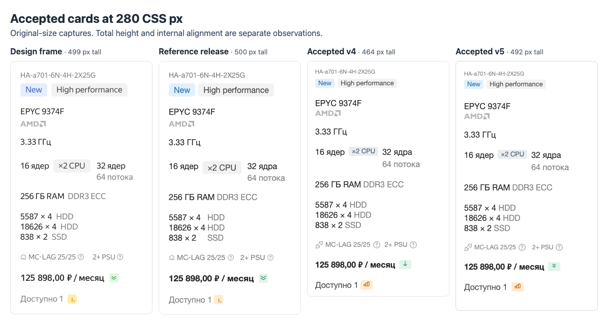

# Full visual comparison

The owner approved publication of these original visual captures for this research record. The [standalone gallery](comparison.html) preserves the 32 embedded PNGs from the full comparison, in the same order. It has a neutral title, English report labels, a time ledger and no private links. To run it from GitHub, open the HTML file, choose **Download raw file** and open the download in a browser. It works offline. Choose **First submission** or **Accepted submission**, then click a capture to view it at 1:1 image size; scroll inside the enlarged view on smaller screens. The inline image above shows the accepted 280 px state without downloading anything.

Each stage includes the design, reference release, v4 and updated v5 at 764, 601, 486 and 280 CSS px. The reference is the same in both stages. Captures are ordered by the width of the card itself. The initial v4 archive had a missing image that prevented the public entry from loading; the first-stage v4 pictures show a diagnostic rendering with that image supplied. Its initial package still failed acceptance.

## What to look for at 280 px

**V5 visibly improves on v4 in several details.** Its overall height, grouping and spacing are closer to the design at this width. The improvement does not establish pixel-perfect reproduction. Comparing the original-size images reveals differences that the seven-pixel gap in total height conceals. The space below the availability text is one detail where v4 (14 px) is closer to the design (22 px) than v5 (38 px).

| Landmark, px from the top of the image unless noted | Design | Reference release | Accepted v4 | Accepted v5 |
|---|---:|---:|---:|---:|
| Image height | 499 | 500 | 464 | 492 |
| Model text, first dark pixels | 93 | 94 | 77 | 83 |
| Memory text, first dark pixels | 260 | 262 | 237 | 243 |
| Price, first dark pixels | 420 | 422 | 395 | 399 |
| Availability, first dark pixels | 463 | 464 | 435 | 439 |
| Space below the last availability text ink, image pixels | 22 | 21 | 14 | 38 |
| First visible model-text pixel on the horizontal axis | 21 | 21 | 17 | 18 |

Measurements use the original 280 px-wide PNGs. For the text landmarks, we inspected the corresponding horizontal bands and measured the first row with dark text pixels in the left text region (x = 7 through 99 inclusive; max RGB channel ≤ 176). The space below availability runs from the last dark text pixel to the last image row. These are ink positions rather than CSS baselines, paddings or bounding boxes. Text rendering and antialiasing can shift an ink measurement; the visible 21 px price offset and 24 px availability offset in v5 are much larger than one pixel.

Compare the size of the top label text and badges, the left content inset, distances between sections, price weight, pictograms and space beneath the availability line. On the 486 px frame v5 reproduces the design's total height; on 601 px accepted v4 is closer in overall height. The question for a reviewer is which individual regions match and which still need an explanation. Passing responsive, selection and overflow checks answers separate questions.

## Acceptance and effort

A worker had to repair the package and public journeys before these implementations passed the study rubric. V4 needed 54:31 of worker time and two returns; updated v5 needed 1:17:56 and three. Including submission judging gives 1:18:54 and 1:36:36. End-to-end calendar intervals were 1:29:55 and 1:41:44. The gallery contains the per-phase table; the [complete accounting](../timing.md) also covers the earlier pilots, resource counters, setup, shared judging, overlap, budget and missing costs.

For a request whose target is pixel-perfect, record the visual fidelity decision for each material state as its own result. When it is achievable, compare the original reference and render on equivalent inputs, fix the discrepancy and recapture. When a source asset, original font, reference state or comparable fixture is unavailable, identify the affected region and the evidence needed to close it. A functional pass with a known material visual difference should be reported as such until the owner accepts the difference or it is resolved.
