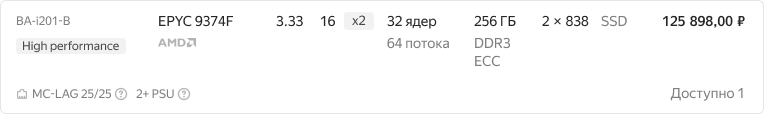
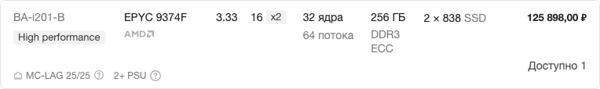
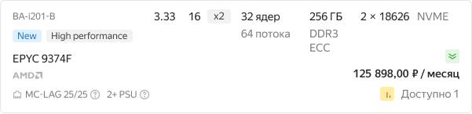
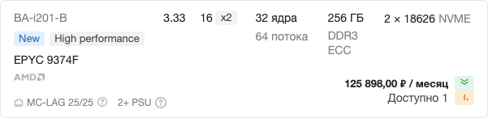
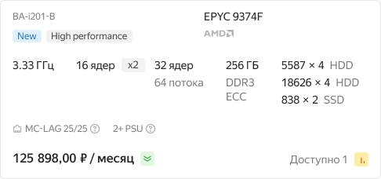
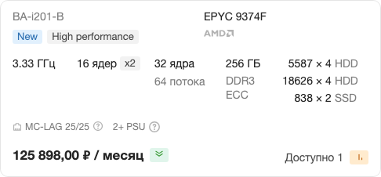
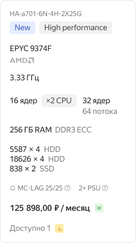
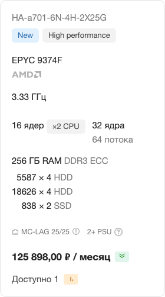
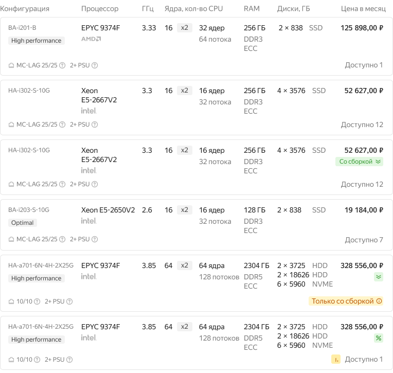
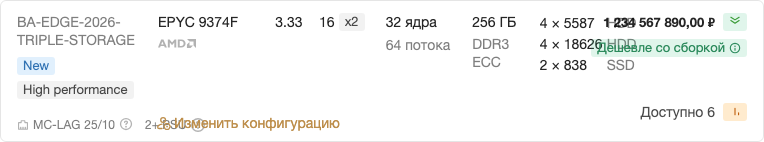

# Real UI task: first submission with design-to-code

## Result and scope

One fresh Terra worker used the experimental `design-to-code` skill on the full responsive-card task. Its first submission was **not accepted**: independent checking of the frozen package found overlapping information and actions, help popovers that stayed open after the pointer left, missing price details in a discount popover, and visible differences from the references. This is one observation with the skill, not a baseline without it. The user chose to assess the first submission instead of continuing a repair cycle. No second submission was made.

The worker did not claim that everything matched: its design-check report listed 0/4 frames passing, and its review named outstanding differences and unverified cases. A later message summarizing judge symptoms was sent before the user stopped the repair; it is not part of the first submission. The package and source snapshots were made before that message.

[Visual evidence](#visual-evidence) includes reference and first-submission views. The complete offline gallery is [available here](09-first-submission-visual-v5.html). On GitHub, download the raw HTML file and open it locally. The initial state used different fixture data and is not a matched before/after comparison.

## Inputs and setup

The worker received an existing library at its historical pre-change revision, relevant excerpts from consumers, the task, the owner's consolidated decisions, 26 reference PNGs and a local copy of the skill from `c112eb2d`. It used Figma MCP; the earlier full-task v4 and v5 workers had image references but no Figma context. Existing components, a local Storybook and package dependencies were available. Differences in instructions, timing of owner decisions, fixtures, model effort and tool access limit comparisons with prior runs.

The worker and judge shared the physical filesystem with past research. The worker's opening tool call searched shared memory for the task number; the returned material included references to earlier reviews and a few prior issue classes. The visible log does not establish that the worker opened the judge's files, read a prior implementation, or used any returned hint. Nevertheless, access to prior information occurred, and the run is not a clean blinded trial. This limitation reflects the agreed lightweight setup; it does not by itself invalidate the observed defects.

## Timeline and observed work

| Event | Local time | Evidence / qualification |
|---|---:|---|
| Worker thread started | 16:37:16 | The worker reported start at 16:37:26. |
| Skill and task read; Figma context requested | 16:37–16:38 | Design context and variables were available. |
| First visual check | 16:40:05 | Four frames plus a sweep; the original and later fixtures differed. |
| First observed product-asset write | 16:41:30 | The worker reported 16:41:35. The first observed TSX edit followed at 16:42:22. |
| Pause and continuation | 16:54 | An account limit warning prompted a stop, then the user chose to continue. The worker reported stopping at 16:54:26; its next turn started 19 ms after the previous turn ended. The interruption’s effect on the submission is unknown. |
| Claimed first-submission timestamp | 17:09:35 | Package hash and test logs were checked at that time. A message to the coordinator was sent at 17:09:51, but its payload is encrypted in the log; the final message confirming submission and the end of the worker turn are recorded at 17:10:04. |
| Independent judge | 17:11:18–17:16:32 | The judge reported active checking from 17:11:30 to 17:16:08. |

From thread start to the worker's claimed submission timestamp: **32:18** wall time, including tool waits and the interruption; to its final message: **32:48**. The judge's reported active interval was **4:38**; its thread lasted about **5:14**. Preparatory workers are reported separately below. No CPU time or cost is inferred from these wall times.

The worker built a shared rendering path, preserved the legacy public components for the other consumer, implemented desktop and narrow layouts, obtained assets from the design, and exercised a built ESM package. Its final targeted tests were 19/19, typecheck passed, and one packed-package smoke test passed in the project bundler. A direct Node CJS smoke failed in a dependency's extensionless import; whether the historical baseline fails identically was not established, so this is not classified as a newly introduced product defect.

The worker ran twelve design-check rounds, each reporting a failure. The first six used image-only specs; text landmarks from metadata appeared later. The final record reported 0/4 frames passed and a passing sweep. However, the original and later stories used different data, and early checks used a different landmark set from later checks. Therefore the score drop from 3072.54 to 832.34 is **not** a controlled measurement of visual improvement. Missing instance metadata also produced some false presence findings. The worker recorded these limitations and the visible remaining differences in its review.

The checked resize interaction used one story and exercised selection, opening network help by click, its link and selection through resize. It did not exercise the desktop sequence of entering help content and moving away. The sweep narrowed a single wide-layout story with one disk and an ordinary price; it did include the wide width where the independent issue appeared, but not the data and action combination that exposed it. In the submitted layout the wide action and network area shared grid space, and in the compact layout the price and disk rows shared space. The popup helper and discount component were reused unchanged from the supplied source. This explains what the recorded path did and why these cases were not exposed; it does not establish whether the popup behaviour was a regression from the historical source.

The references included a separate ordinary-discount image containing both prices and date format. The worker explicitly inspected two other price-related design nodes before submission; the first explicit opening of this particular image in the worker transcript was after the judge's return. That observation does not rule out indirect exposure via other Figma context, and does not establish the worker's internal reasoning. The worker started from the historical pre-change source. A later release served as the judge’s separate behavioural control.

## Independent first-submission acceptance

The judge checked the submitted public archive, then ran the existing browser suite and reviewed newly captured images against the references. The script's exit 0 means the runner completed, not that the submission passed. Its raw records were 41 PASS and 15 BLOCKED_OR_FAIL out of 56; some PASS records only captured observations and several failures were locator or text mismatches. The judge rechecked those cases and did not count 15 as separate product defects.

Observed material issues:

1. At a wide card size, a long price and build label overlapped disk values; a configuration action overlapped the power value and blocked its help target. At a narrower width, a price overlapped the last disk even with a normal-sized price.
2. After the pointer entered a help popup and left, several network, build, price, discount and stock popups remained open. The power popup could not be assessed because the action intercepted its target.
3. A discount popup omitted the old and new prices; the sign and date formatting differed from the reference.
4. The compact and mobile frames still differed in the placement of price/stock icons, disk alignment and text weight. Frame heights were close in some cases; correct height alone did not imply visual or behavioural parity.

Selection and continuation, request and template flows, the low-stock flag case, a mobile network sheet and a legacy adapter were exercised in the local host. Two touch cases remained unverified because of fixture/locator limitations; the whole consumer applications were not run. GPU was rendered with different fixture data, so pixel-level equality was not established. The judge used the saved reference images, not a fresh live Figma verification. These are observations for the submitted package, not a proof that each issue was introduced relative to the historical pre-change source.

## Visual evidence

The reference and submitted cards use the same stated card widths. Some data and labels differ, so individual visual findings must be assessed in that context. Open the [offline gallery](09-first-submission-visual-v5.html) for the initial stories and the GPU, network and discount states.

| Reference, 764 px | First submission, 764 px |
|---|---|
|  |  |

| Reference, 601 px | First submission, 601 px |
|---|---|
|  |  |

| Reference, 486 px | First submission, 486 px |
|---|---|
|  |  |

| Reference, 280 px | First submission, 280 px |
|---|---|
|  |  |

The wide reference group below includes multi-disk cards; the submission is the 764 px stress fixture. No design frame uses exactly these data and actions. Compare placement relationships, not exact values or pixel parity.

| Closest design reference, wide group | First submission, dense fixture |
|---|---|
|  |  |

The initial story used different fixture data. It records the starting layout and is not a pixel-matched before/after comparison.

## Token and time accounting

The native session logs contain individual response-usage records and cumulative thread totals. For the listed boundaries, the sum of individual records was cross-checked against the last cumulative record. Cached input is a subset of input; uncached is input minus cached. Reasoning is included in output, not added to it. These are cumulative processed tokens across model responses, not unique context size or billable cost.

| Role / boundary | Input | Cached input | Uncached input | Output | Reasoning inside output |
|---|---:|---:|---:|---:|---:|
| Preparation, final | 2,590,891 | 2,520,832 | 70,059 | 11,419 | 1,773 |
| Preparation verifier, final | 457,887 | 396,672 | 61,215 | 4,099 | 313 |
| Worker, claimed submission 17:09:35 | 40,960,616 | 40,536,320 | 424,296 | 66,870 | 17,546 |
| Worker, completed handoff 17:10:04 | 42,004,818 | 41,579,392 | 425,426 | 67,880 | 17,973 |
| Judge, final | 3,434,719 | 3,361,024 | 73,695 | 10,024 | 1,633 |
| Coordinator, approximate interval | 65,557,461 | 65,517,312 | 40,149 | 22,779 | 10,724 |

The four final role totals above sum to 48,488,315 input, including 47,857,920 cached, and 93,422 output. This excludes the coordinator, platform/approval processes, any other turns, and the post-submission return. The coordinator row is a separate bounded approximation: it starts with the last response 34 seconds before preparation began and ends with the last response 9.5 seconds before the judge finished. Its 169 per-response records sum to the cumulative difference and have the root thread id; their response ids do not overlap with the four inspected subagent threads. Some unrelated or encrypted coordination may be included, so it is not an exact task-only cost. Preparation included some baseline setup before the user cancelled that arm, so it is not all necessary cost of a one-arm run. Provider accounting and pricing are not known. The previous report said token totals were unavailable; the session records show that statement was wrong.

Preparation worker active turn durations were 292.234 s and 52.268 s, with an interruption between them; the independent preparation verifier's turn was 92.037 s. These are not summed with the worker/judge as a wall-clock duration, and shared setup and coordinator time are not fully accounted for.

## What worked, what did not, and why this is uncertain

**Observed as useful:** the worker accessed Figma context, inspected the existing UI-kit and consumer contracts, retained the legacy path, produced a package and locally tested it, exercised selection through resize, and reported unresolved discrepancies instead of declaring the design check green. The independent judge isolated real product observations from fixture/locator failures.

**Observed gap:** the checked inputs were narrower than the task's possible data and interactions. In particular, one fixture did not expose the dense layout failures, and the recorded interaction did not check hover dismissal after entering popup content. The skill tells the worker to consider long data and to preserve state on resize, but it did not result in these specific user journeys being checked before submission. It called for a pre-implementation design review; the first recorded review file was written at 16:59, after implementation and several visual rounds. The record does not establish whether the cause was the skill wording, the worker's execution, tool feedback, time pressure, or some combination.

**Measurement limits:** the final visual checker still flagged all four frames, partly on incomplete metadata and differing inputs. Its number of findings cannot be treated as a count of independent defects or a definitive pixel-parity verdict. The coordinator asked not to spend time on cosmetic repeats of checks already run; the exact wording was delivered in a message whose payload is encrypted in the worker log, and its causal effect is unknown. The later explicit user instruction stopped further remediation. The shared account was near its limit, but its percentage is neither model-specific nor a token-cost measure.

An earlier small pilot tested an optional early independent observer on a different two-selector task. Both conditions needed one return; the observer spent 4:46 over two visits and both conditions missed an autofocus issue. Measured totals differed by approximately 43 s in favour of the observer arm after both were accepted, but one run per condition does not establish a causal speed-up. That pilot does not prove the same result for complex cards.

## A candidate: design the responsive relationships before styling

The submitted implementation did have shared structure: one card body and shared column definitions for the table header and rows. It was not four separate pages assembled from screenshots. Nevertheless, in one layout the network/power group and the edit action occupied overlapping grid space; in another, the price occupied part of the disk area. The judge reproduced the resulting interference with actual data and a pointer target. At the wider size, the long price and disk contents were in separate columns, so the evidence does not establish the same grid-area cause for every overlap. The popup dismissal issue is also separate.

A possible improvement to the skill is a small pre-implementation layout map for work where relationships change across widths. Derive it from the design, the existing component and its consumers: identify groups that move together, edges that must remain aligned, conditional actions, and what wraps, moves or increases height as neighbouring content grows. State which transitions the design actually shows and which are inferred; do not treat screenshot widths as prescribed breakpoints. Different hosts may have different available widths and need not share a single breakpoint. The map does not prove how the browser will lay out the result; growing in height is one possible rule, not a separate requirement invented from the reference.

Use one ordinary reference-matched example and one legal combined case with longer or additional content and available actions. Keep the same data while crossing a transition in both directions, and test readability, shared alignment, each action's target and retained state. If the design is inconsistent or the choice changes behaviour, present the alternatives to the owner; a routine wrap need not trigger a question. Choose Grid, Flex or supported UI-kit composition according to the relationship rather than mandating a particular primitive.

The skill already mentions starting with the container, common columns, wrapping, long data and state across resize. The proposed addition is to make the relationships and the rule for competing content explicit *before* detailed frame tuning, and then challenge that rule on a combined case. For a small change with one obvious layout, a short explanation and a normal render check are sufficient; a separate architecture document or extra agent is not automatically justified. This is a hypothesis for discussion. It has not been implemented in the skill or evaluated.

## Candidate roles and next experiments

These are hypotheses, not changes validated by this run.

- **One independent prober:** inspect the first functional slice and, before handoff, real public entry points at representative states/data/widths. Check both visuals and actual interactions. Return reproducible symptoms and expected/observed behaviour, not implementation instructions. The worker fixes and the prober retests; a genuine blocker or repeated lack of progress is reported instead of hidden.
- **Two specialists where complexity warrants it:** one examines references, responsive layouts, content extremes and visual differences; the other examines actions, hover/touch, state across resize and consumers/package contracts. They send a deduplicated issue list. The second role is a candidate when the task has substantial visual states and a separate complex user journey that one reviewer cannot cover in the allotted time. Their extra time, tokens and handoffs must be included in any result; parallel work is not free.
- **No added standing role:** keep the existing single worker but improve how it derives representative data and interaction checks from the specific task and existing product. This is the lowest-overhead alternative, but remains untested on the observed failures.

### A small test of one versus two reviewers

Astra proposed a narrower, cheaper question before funding another complete implementation. Freeze the same newly produced intermediate implementation and acceptance inputs; do not reveal this run's findings to the reviewers. Reviewers A and B receive the same general brief, access, model and budget per window, without each other's feedback. A works for two equal windows and seals an interim report after the first; B independently gets one window. Both reports are sealed before deduplication. Compare A after two windows with the union of A's first window and B's one window: both receive the same aggregate reviewer-time budget. A separate judge first evaluates the snapshot without seeing reviewer findings, then verifies their reproducibility, misses against the known judged set, duplicates, false positives and unverified cases. A zero added finding is a possible outcome.

The compared strategies each cost two reviewer windows; conducting this particular experiment costs three reviewer windows in total, plus the independent judge. This compares two strategies at equal reviewer time; they differ in continuity and adaptation as well as in the number of perspectives. It does **not** isolate the effect of reviewer count or measure the effect on a full implementation, user returns, elapsed delivery time or remediation quality; a later paired end-to-end run would be needed. Specializing A and B would test specializations and their allocation together, rather than the number of reviewers alone. Record n=1, preparation and coordinator time separately, and freeze the criterion before seeing findings.

Keep the frozen submission in this report as a historical reference, not as a controlled control arm for an intervention designed after its findings were disclosed. To estimate downstream effects, compare fresh implementations with the same skill, inputs, model/effort, limits and evaluation, with and without the independent-checker intervention. Record design state, coordinator messages, quota limits, shared filesystem and other remaining differences. The independent judge must not see either arm's feedback or known findings before its own assessment. Count first-submission quality before and after the internal checkpoint, final correctness, returns to the human, internal returns, total wall time, worker/checker/judge tokens and unresolved cases. One pair is a case study, not a general reliability claim. A separate no-skill baseline is a possible later question, not a prerequisite the user has requested for this run.
