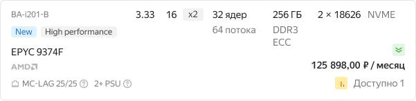
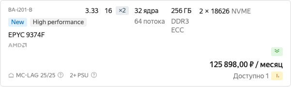
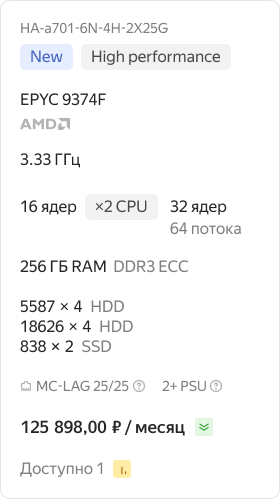
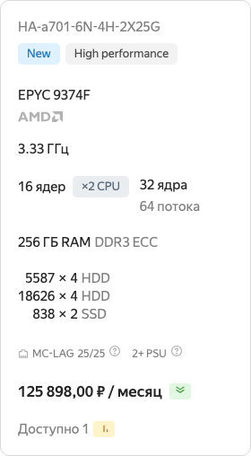

# Two first submissions with draft 14: what worked, what did not, and what to change

## The decision this record supports

The experimental skill aims to deliver an adaptive interface that the owner can accept on the first submission, with the design, interactions and remaining differences checked. We ran one small public case and then one real library task with the skill from commit `52fb5dae`. The small case met its registered materiality threshold after a judge-selector correction; the real submission was **not acceptable**: it had visible design differences and the packaged consumer could not load. Both are individual observations, not a measured effect of the skill: the owner chose **not** to rerun a no-skill baseline, and the two cases differ.

The skill did help make the real handoff honest in the observed run: the worker reported the failed visual check, unexamined references and an unaccepted deviation rather than asserting visual parity. Whether that happened because of the skill is not established. We did not ask the worker to repair the returned submission.

[Visual report: design reference and first submission together](11-first-submission-visual.html). Download the raw HTML and open it locally. It includes all four paired card frames, old template references against new template examples, the two available tooltip references and screenshots, dense examples alongside the closest ordinary-data frame, and the two small-case examples. Differences in data, intent or reference age are identified alongside the pair. An original-state screenshot using other data or width is disclosed separately, not presented as a controlled before/after. The report does not claim that a screenshot with no corresponding state or fixture proves parity.

## The two runs

| | Small public listing | Real adaptive library card |
|---|---|---|
| Worker | fresh Terra, xhigh | fresh Terra, xhigh |
| Skill | draft 14, `52fb5dae` | same |
| Input | provided frames and kit, variant without kit popover | pre-change library snapshot, consumer excerpts, owner decisions, Figma access and 26 exported images |
| Baseline arm | not rerun at owner's direction | not rerun at owner's direction |
| First submission | `pending`: differences up to 3.77 px proposed to owner | `fail`: 0/4 compared card frames; additional references and states not fully checked |
| Worker thread | 5:37 to final message; worker reports 5:17 to submission | 25:10 to final message |
| Check rounds | 5 including baseline | 10 including baseline |
| Tool calls | 34 | 167 |
| Input tokens | 2,124,596, of which 2,078,208 cached and 46,388 uncached | 29,739,848, of which 29,554,816 cached and 185,032 uncached |
| Output tokens | 12,166, including 2,481 reasoning | 56,551, including 15,299 reasoning |

Token totals are cumulative transcript counters, not the size of a single context. Output includes reasoning; do not add the reasoning again. They exclude the coordinator, browser and independent judge. The small run's permission-review helper separately reported 178,351 input (143,232 cached) and 883 output tokens. The real run's permission-review helper separately reported 1,725,551 input (1,596,928 cached) and 1,809 output tokens. These counters are shown separately to avoid conflating an executor with permission review. No monetary cost is inferred from token counts. Time is elapsed worker-thread wall time, not CPU time; preparation, independent acceptance and reporting are additional.

The workers shared a filesystem with prior artifacts and were instructed not to consult other solutions or the judge. No physical read isolation was enforced; neither run should be called blind. The real worker used the available Figma context; saying Figma was unavailable would be wrong. The historical snapshot and dependency links are not a self-contained distribution. The coordinator accidentally included a local Storybook cache in the temporary Git baseline; the worker was told not to add cache changes to product commits. That setup mistake did not alter the PR or the original project.

## Small case: result and limits of the judge

The worker implemented the design, used five check rounds, recorded eight interaction journeys and gave an honest pending handoff. The independent judge's frozen code initially returned the submission: its broad popup selector matched an anchor before the popup, so the dimensions belonged to the trigger rather than the popup. A separate diagnostic copy changed only the target selector; it did not change the submission. Under this case's pre-registered rule — position/size differences at most 4 px are not material — the corrected check found no material frame differences, the dense story actually rendered with three screenshots, and the judge's interaction checks passed. This is **not** an owner acceptance of the worker's proposed differences, nor a universal 4 px product tolerance.

The judge itself is not safe as an unchecked gate. On a prepared negative control in which the dense card never rendered, it printed `ACCEPTED` even though the underlying checker recorded the missing root. It builds the dense verdict from the list of overlap issues and does not make an unmeasured dense story fail. The `RETURNED` caused by its broad selector is the opposite error: the measuring setup, rather than the submission, was wrong. See [judge.mjs](../../evals/design-to-code/cases/listing-card/judge/judge.mjs), especially the selector, density and final-verdict logic. The corrected diagnostic result is qualified evidence, not a retroactive change to the frozen judge or a general success rate.

## Real task: what the first submission contained

The worker attempted one rendering path for the card and its template consumer, added thread and network/power information, retained legacy public pieces, and used the supplied low-stock flag. Its own report records: 100 targeted tests in 12 files, typecheck and stylelint passing, seven journeys holding and a sampled 280–800 px sweep without detected overlap. These are the worker's reported results, not a rerun by the coordinator. The dense fixture did not combine all assembly actions and discounts; screenshot-only references left text for a person to inspect; other browsers, real devices, assistive technology and live consumer integration were not checked.

The four captured cards had these dimensions, in CSS px:

| Width | Reference height | Submitted height | Difference |
|---:|---:|---:|---:|
| 764 | 114 | 119 | +5 |
| 601 | 146 | 179.08 | +33.08 |
| 486 | 228 | 232 | +4 |
| 280 | 499 | 507.95 | +8.95 |

These measurements describe the recorded fixtures, not a rule that equal card heights alone prove a match. The worker's design check reported 0/4 frames passing. The image comparisons were reviewed by eye as well; for example:

| 601 px — design | 601 px — first submission |
|---|---|
|  |  |

| 280 px — design | 280 px — first submission |
|---|---|
|  |  |

At 601 px the price was moved below the disk area even in the illustrated one-disk reference. At 280 px the disk values' alignment differs. The price-discount label was still text rather than the requested icon. The first difference was proposed by the worker as a possible design trade-off, not accepted by the owner. The **other 22 images were not all automatically compared**: the collection includes complete screens, cropped details, states, old template examples and a selection boundary, so neither "22 passed" nor "22 missing full pages" is a sound interpretation. Several additional screenshots were taken, but a matching reference or a matching data set was not established for each.

After freezing the submission, the coordinator built and packed it. Build and the independent consumer's typecheck completed, but the consumer app did not load: its built JavaScript referenced six SVG files absent from the package. A successful build and source typecheck therefore did not establish that the package could be consumed. The first cases timed out for the same module-resolution error, and the rest were stopped rather than counted as individual product failures. Browser acceptance of that built package remains **not completed**. No product repair was made after this finding.

## Why this submission fell short

### Relationships at different widths

The worker found a real risk: a longer multi-disk configuration could conflict with the price or discount. Its chosen compact layout moved the price below the specifications for the whole layout. That protected that arrangement but also changed the ordinary one-disk reference; necessity of the same expansion for every card was not shown. This is a specific observed decision, not proof that growing in height is wrong for the dense case. At 280 px, the submitted disk numbers align to a different edge than in the reference. It is a separate mismatch: correcting the overall card height alone would not establish alignment parity.

A useful design question before implementation is: what shares an edge or column, what must stay together, what happens when a neighbour grows, and which transitions are actually shown versus inferred? The answer must then be exercised with an ordinary reference-matched fixture **and** a legal combined-content fixture. Reusing a grid or a kit component is not enough to prove that its placement preserves those relations. The case does not justify mandating a particular CSS primitive or a large architecture document for every small edit.

### The checks did not cover everything their summary could suggest

The worker obtained Figma context, yet the four checked frames used image-only specs with no text landmarks. Four of 26 supplied images were registered as comparison frames. The remaining files were not all equivalent acceptance targets: some were context, old examples, sub-elements or cropped screens. A better review needs a role and an outcome for each relevant reference, not necessarily 26 independent page renders.

The original `before` came from another story and did not share the later fixture or host width. The working story also changed the displayed data at some widths. That can be useful to reproduce different reference screenshots, but a resize of that story does not isolate how **one and the same** set of data adapts. The dense story used stable data and partially addressed that limitation. The final sweep samples widths at 80 px plus the configured examples; it is not exhaustive evidence for every pixel or every combination of labels and actions.

The transcript shows that the four reference/submission pairs were opened before the final price-indicator changes; after those changes, the recorded visual inspection covered a narrower selection. This is evidence that the **final** pairs were not all revisited in the recorded path, not proof of what the worker thought or saw through an unrecorded channel. A final human/agent look remains important even when numbers are available. For screenshot-only references the checker reports image-only rather than proving text correctness; a manual comparison can provide evidence for an owner decision, but must not be silently upgraded to a machine-measured result.

### Feedback and stopping

The worker executed ten check rounds. Within one unchanged measurement basis, two rounds after the best score were worse; later the measurement basis changed. Scores across different bases cannot measure progress, and even a comparable aggregate score does not establish that a specific acceptance condition holds. The final output was honest, but the observed process did not converge to an acceptable first submission. The record does not establish that a longer run, a second agent, or another instruction would have solved it faster.

## Review of the current implementation at `52fb5dae`

These are findings about the checker and evaluation, not fixes applied by this research:

1. **Closing coverage can be falsely credited.** A journey touching a trigger and checking an unrelated, never-visible element as `hidden` is counted as closing that trigger. The added test accepts exactly that shape. See [the journey result](../../plugin/skills/design-to-code/scripts/design.mjs) and [the control test](../../evals/design-to-code.test.mjs). The browser test was run. A meaningful close claim needs evidence that the relevant content was observed and later hidden in the applicable journey; a control with no requested closing behaviour should not be forced into that model.
2. **Filled is not passed.** The acceptance parser treats any nonempty result as complete. An in-memory check with `keyboard: FAILED` and `desktop: not checked` produced no acceptance gaps. Those rows by themselves do not prevent an overall pass when the other automated results are green. The result was reproduced against the actual functions; a full end-to-end browser run for that minimal example was not made.
3. **A selected root can be skipped.** Both Figma extractors ignore a selected TEXT node itself when building landmarks; synthetic direct calls returned an empty list for a text root. The opener scan uses descendant-only `querySelectorAll`, so a root element that is itself an opening control is omitted; that second claim is from source reading and was not separately reproduced in a browser. See [core.mjs](../../plugin/skills/design-to-code/scripts/core.mjs) and [design.mjs](../../plugin/skills/design-to-code/scripts/design.mjs).
4. **Uniform mandatory work is expensive and can be inapplicable.** A full check requires a separate dense story; the skill also asks for two additional probes and a commit at every new lowest score. A static surface may have no variable data or relevant interaction. This is a design concern about the default workflow and should not be confused with a reproduced product failure.
5. **The listing-case judge needs its own calibration.** The absent dense root false pass and the popup-anchor false return above affect the experiment's observer. Fixing a case-specific judge does not fix, or by itself condemn, the product checker.

The independent review also reproduced the existing test for the false close credit. Skill-page checks were 8/8 and package checks 21 passed, 1 release-tag-only skip. A full browser suite attempted in a sandbox could not launch Chromium; one targeted browser test ran successfully after escalation. These are not a claim that the complete browser suite passed.

## Recommendations discussed with an independent Astra reviewer

These are a **plan for review**, not changes made in this report:

1. **Make evidence claims honest.** Fix the false closing credit and root-node omissions; distinguish pass, fail, unknown/not checked and proposed from free-text descriptions, and make the evidence attached to a required criterion explicit. Preserve a way to report a partial or screenshot-only result without turning unknown into pass or an endless automatic failure. Do not parse arbitrary prose as proof that behaviour passed.
2. **Put a short, comparable reference loop in the critical path.** Identify the source, required outcomes and existing UI-kit patterns. Record the important relationships that change across widths when the surface is complex. Compare the same relevant state, data, host width and scale; look at the final reference/submission pair after the last visual change. Label unmatched before pictures and intentionally different data. Images are evidence in their own right; numeric tools supplement them.
3. **Test the actual delivery boundary when there is one.** For a library change, verify an early and final packaged-consumer smoke path, including referenced assets and a real import, using the project's supported build and consumer mechanism. The existing [review guidance](../../plugin/skills/design-to-code/references/review.md) already mentions a built package, so make it actionable rather than introducing an unrelated test stack. For authentication use the established persistent Playwright profile only when needed; use a clean browser for an unauthenticated local component environment.
4. **Scale the workflow to the work.** Dense data, responsive sweeps and interaction journeys apply when variable data, responsiveness or interactions are in scope. Select cases from legal task data and existing behaviour; there is no universal requirement for a separate dense URL, exactly two probes, a Git commit after every score change, or several copies of the same handoff. Preserve partial results and explicit limitations. Keep score as a diagnostic, not the goal or an owner verdict.
5. **Calibrate the observer before using it as a gate.** Test each judge on a known-good control and individual planted failures; treat a broken selector or unavailable measurement as `indeterminate`, not accepted or returned. Freeze case, judge and outcome criteria before a run. If the judge changes, retain the old result, explain the change and consistently rerun affected results. Keep synthetic-case tolerances local to that case.
6. **Consider an independent reviewer as an optional experiment, not a default requirement.** One observed run cannot establish that one or two agents would reduce cost or returns. Test a small early check separately with a fixed aggregate budget; count worker, reviewer, judge, coordinator, uncached input and output. A reviewer should report reproducible observations, and the final frozen submission must still be judged independently.

For the next evaluation, compare current and simplified instructions on the same inputs with fresh workers and frozen criteria. Include a static screenshot-only surface, an interactive Figma/kit surface, and an adaptive library with an actual consuming artifact. Primary outcome: independent acceptance of the **first** frozen submission; secondary outcomes: material misses and false findings, unchecked states, wall time, tool calls and total token costs. A later no-skill baseline can answer a different question, but was not requested for these runs. One example per arm is exploratory, not a ranking.

## Other review time and cost

The two reviewers of the current branch ran in parallel. Their transcript counters were: Astra, 803,345 input (689,792 cached; 113,553 uncached), 4,017 output and 9 tool calls; Terra, 795,138 input (749,568 cached; 45,570 uncached), 3,367 output and 13 tool calls. Their initial threads lasted about 3:10 and 1:40 respectively; a short follow-up to Astra is not included. These are review-worker totals, not end-to-end coordinator, permission-review or browser costs. A later independent Astra analysis reviewed the frozen artifact and transcript: its thread lasted 3:45, with 1,814,233 input tokens (1,709,056 cached; 105,177 uncached), 8,218 output tokens and 19 tool calls. Its cost is separate from the implementation runs. No success rate, financial cost or causal improvement can be calculated from these observations.
