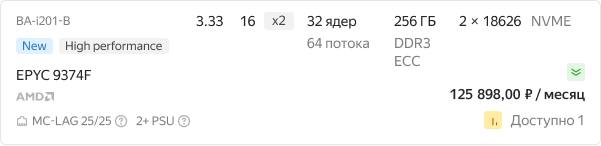
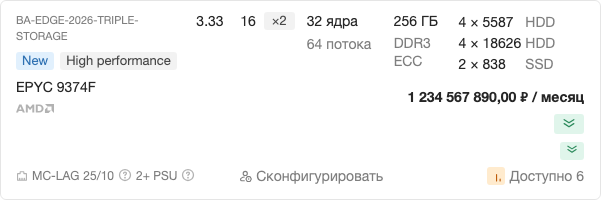
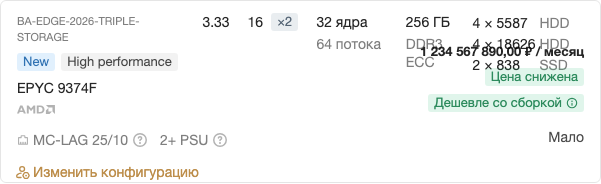

# After five iterations: why the last first submission was returned

## Decision and evidence

The objective is an agent that can deliver an adaptive frontend from its design on the **first submission**, with the requested appearance, interactions and consumers checked, without the owner repeatedly directing repairs. Five implementation iterations were run. The fifth first submission was **returned**. Draft v20 was revised after that result but has not had another implementation trial. The owner asked for a plan for iteration 6; this record does not start or approve that iteration.

The detailed [five-run statistics](17-iteration-summary.md), [full fifth-run record](16-iteration-05.md), [checker calibration](18-frozen-dense-calibration.md), [before-image audit](19-before-conditions.md), and [role accounting](20-coordinator-accounting.md) remain available. The [visual report](16-iteration-05-visual.html) pairs the four main references with the submitted output and labels cases whose data differs. The [dense-data comparison](18-frozen-dense-visual.html) puts the ordinary-data reference beside the same stress fixture in the release and the frozen submission. Download the raw HTML reports and open them locally.

The [focused visual report](21-fifth-submission-visual.html) also pairs the mobile and network-popup references with the recorded result. The following images show the central failure in GitHub. The reference is the ordinary 601 px design; the other two use the same **different, denser fixture**. Their rendered labels and actions differ between implementations. The design image gives visual context, not a pixel-identical reference for that stress state.

| Reference: ordinary data, 601 px | Released control: dense data, 601 px | Fifth submission: same dense data, 601 px |
|---|---|---|
|  |  |  |

## What happened, and what the evidence says

### 1. Resize coverage did not establish readability

At 601 and 624 CSS px, a long price visibly intersects disk text. Independent DOM Range measurements put the overlap at approximately **59.45 × 8.92 px** and **62.89 × 11 px** respectively. The same fixture and consumer in the released control did not overlap. The worker's resize probe checked the card's width, scroll/client dimensions and selection. The independent `resize` scenario checked width and text presence. Those conditions can all hold while two pieces of text occupy the same space; its recorded PASS is valid only for those assertions.

The current checker later found the overlap at both widths when given the actual consumer and the relevant dense fixture. Its control sweep found no overlap on the release. This proves a **specific** detection capability, not that an agent will independently choose representative data, run the checker or act on its result. The checker was not observed in the fifth worker's recorded command path. The fixture is a legal synthetic stress input; its production frequency is not established.

### 2. A test repeated the mistaken interpretation

For a low-stock example, the submitted component showed the translated low-stock label **instead of** the availability count. The task's agreed behaviour and the reference required an indicator alongside the count. A submitted test explicitly expected the count to be absent in that condition. Thus a passing test suite demonstrated consistency with the test's expectation, not consistency with the task. The worker reported 43 passing targeted tests; the independent observer confirmed the displayed content and source condition. The correct lesson is to derive an expected result from the requirement, reference and data contract, rather than only from a newly written implementation.

### 3. Reference coverage was reported but not completed

The final report included all 26 supplied images, but reused seven different output screenshots across them. It labelled many references as context, different data or not reproduced. The four main captures used the real ready-card component, which is stronger evidence than the earlier internal-row capture. They still did not all have reference-matched disk, discount or low-stock state. Their observed height differences are real for the captured inputs, but different data and visible states prevent treating all of those differences as pure layout defects. A visual result placed beside an unrelated state is useful context only; it does not close that state's acceptance criterion.

### 4. Different gestures produced different evidence

The worker opened a network popup by click, inspected its content/link and sent Escape, but the recorded script did not assert that the popup disappeared before moving to the next control. The independent pointer sequence entered the network, power and assembly popups and then moved away; their content remained visible at 0.3, 1.3 and 3.3 seconds. That is an observed behaviour gap for the expected dismissal sequence. Whether it was introduced by this change was not re-established. An edit-action check timed out on one label while the page exposed a differently worded action; an independent check did open the editor, so the timeout alone is not a confirmed edit regression. The GPU assertion in the main scenario stopped at an earlier low-stock assertion; a separate 280 px GPU edge scenario recorded content and a screenshot. That observation does not establish complete GPU correctness or design parity.

### 5. The package boundary improved, without proving the whole goal

The previous real submission's public package failed to load because image imports were missing. In the fifth run the worker itself found and corrected packaged-asset problems, and independent ready-card and site smoke checks loaded the built public export. That is a positive observation on this run, not proof that the instruction caused it. A successful build, typecheck, package smoke or passing subset remains narrower than full visual and behavioural acceptance.

### 6. The handoff was honest; completion was not achieved

The worker had read the skill, received Figma and the prior owner decisions, and disclosed unverified GPU/discount/assembly/mobile-tooltip cases and visible differences. It did not claim perfect parity. What the available record does **not** reveal is why it chose to submit while those conditions remained unresolved. The evidence supports a gap between identifying outstanding acceptance work and completing it; it does not establish an internal motive, a lack of tools, or a quota-related cause. The next proposal targets that gap while preserving honest reporting of genuine blockers and owner decisions.

## The checker and observer are evidence, not the owner

A separate screenshot-only pilot produced a strict machine failure; a control with identical rendered RGB pixels and different internal text line-height also failed. Those internal line boxes are meaningful when supplied in a real typography specification, but a screenshot alone does not reveal them. A screenshot-only verdict should use the visible pair at the same scale and distinguish visual defects from diagnostics. The original strict verdict was retained, and owner acceptance of that pilot is unknown.

A follow-up on before-image provenance reproduced an earlier capture from another width and query shown under an unqualified `Before`. The checker now preserves that image and labels changed or unknown capture settings. Matching settings do not prove unchanged server data or theme. Its demonstration regenerates the synthetic reference from the current page at each step; its PASS is a self-comparison, not proof of independent design parity.

## Five iterations and cost

| Iteration / draft | First-submission outcome | Worker wall | Worker input uncached | Worker output |
|---|---|---:|---:|---:|
| 1 / v15 | returned: one 6 px listing mismatch | 5:22 | 38,081 | 13,023 |
| 2 / v16 | returned: same listing mismatch | 5:16 | 39,557 | 11,920 |
| 3 / v17 | returned: built public consumer could not load assets | 15:14 | 135,497 | 33,235 |
| 4 / v18 | strict screenshot judge failed; visual review and owner decision distinguished | 2:43 | 27,627 | 6,464 |
| 5 / v19 | returned: dense overlap and state gaps; package smoke passed | 23:47 | 177,597 | 49,899 |

Output includes reasoning. These figures are one run per draft on different tasks; they do not estimate causal improvement or a reliable success rate. The owner declined a new no-skill baseline. Workers shared a filesystem and were asked not to inspect prior solutions; these are not blind runs.

For the entire five-iteration turn, the coordinator's journal recorded **1,061,729 uncached input**, **267,968,256 cached input** and **133,400 output** tokens. Across 23 linked local journals, including those workers, review and permission checks, the measured subtotal was **2,989,075 uncached input**, **365,746,560 cached input** and **365,151 output** tokens. Output includes reasoning; do not add it again. These are logged token counters, not monetary billing, and they exclude unobserved services, browser/CI resource use and work outside the measured window. The coordinator made 191 `wait_agent` calls; the records do not assign token cost to individual waits and cannot establish savings from a polling change. The separate [accounting report](20-coordinator-accounting.md) gives role-level scope and method.

## Implications for iteration 6

The main issue is not a demonstrated inability of the checker to find dense overlap; it found the specific overlap when supplied an appropriate fixture. The proposed next change is a verifiable transition from an **applicable requirement and a real observation** to one of: fix and recheck, an explicit blocker after an attempt, or an owner decision. A mere screenshot count, a green test whose expectation repeats the implementation, or a width-only resize assertion cannot close a richer acceptance condition.

A second standing agent is a separate hypothesis. A prior early-prober pilot on a different, smaller task took 4:46 for two visits; both arms still needed a return and both missed autofocus. It does not prove that a prober would or would not help this task. The proposed [iteration 6 plan](22-sixth-iteration-plan.md) recommends one fresh implementer and an independent first-submission assessment first, with an early prober as a separately measurable option rather than a mandatory rule. No new implementation, extra worker run or skill edit was made for this report.

## Cost of this postmortem and plan review

After the five-iteration window, the advisory agent requested as Astra xhigh recorded 132,767 uncached input, 1,994,240 cached input and 10,806 output tokens across its initial analysis and follow-up; its thread spanned 9:06 including the interval between those turns, with 20 tool calls. The independent reviewer requested as Terra xhigh recorded 66,695 uncached input, 960,768 cached input and 4,155 output tokens over its initial 1:39 thread, with 12 tool calls. The reviewer figures stop at the completion of the initial review (00:48:11 UTC, 2026-11-21); the later accounting follow-up is excluded. Effective model/effort was not separately reported. Output includes reasoning. These are additional to the five-iteration subtotal above and do not include the coordinator, browser or permission-review costs for this reporting work; monetary charges remain unknown.
